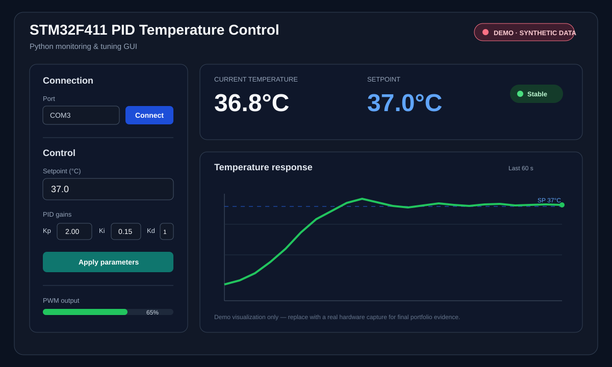

# STM32F411 PID Temperature Control System

A portfolio-oriented embedded control project built around the **STM32F411**.  
The system acquires temperature data, executes a timer-driven discrete PID controller, generates PWM for an external heater/actuator stage, stores configuration in W25Qxx SPI NOR Flash, and communicates with a Python desktop application for monitoring and parameter tuning.

> **Recruiter note:** this repository focuses on firmware architecture, peripheral integration, control logic, serial protocol design, and PC-to-MCU integration. Performance figures such as overshoot, settling time, or temperature accuracy are intentionally not claimed because the repository does not include a complete hardware test dataset.

## Recruiter Snapshot

| Area | Implementation |
|---|---|
| MCU | STM32F411 |
| Firmware | Embedded C, STM32 HAL |
| Control | Discrete PID, timer-scheduled control loop |
| Actuation | TIM3 PWM output |
| Sensor | DHT22 temperature acquisition |
| Local UI | 16x2 LCD, 4-bit interface |
| Non-volatile storage | W25Qxx SPI NOR Flash |
| PC communication | USART6, 115200 baud, Receive-to-Idle DMA |
| Protocol | Custom binary frames, CRC16-Modbus, byte stuffing |
| Desktop tooling | Python, Tkinter, PySerial, Matplotlib |

## Demo

**Demo-data disclosure:** the preview above matches the included `pc-gui/demo_gui.py` portfolio demo and uses synthetic temperature data. It is intentionally not presented as measured hardware performance.

## System Architecture

~~~mermaid
flowchart LR
    S[DHT22 Temperature Sensor] -->|Temperature feedback| MCU[STM32F411 Firmware]
    MCU --> PID[Discrete PID]
    PID --> PWM[TIM3 PWM]
    PWM --> H[External Heater / Actuator Stage]

    MCU --> LCD[16x2 LCD]
    MCU <-->|SPI| FLASH[W25Qxx SPI NOR Flash]

    PC[Python GUI Tkinter + Matplotlib] <-->|USART6 115200 Receive-to-Idle DMA| MCU

    PC -. Setpoint / PID gains .-> MCU
    MCU -. Temperature / status .-> PC
~~~

A recruiter-friendly static version is also available below.\n\n

## How It Works

1. **Acquire temperature** from the DHT22 sensor.
2. **Compare** the measured value with the configured temperature setpoint.
3. **Execute the discrete PID controller** on a periodic timer-driven schedule.
4. **Apply the controller output** through TIM3 PWM to the external actuator/heater-control stage.
5. **Display local information** on the 16x2 LCD.
6. **Exchange data with the PC application** over USART6 while setpoint and PID gains can be persisted to W25Qxx Flash.

The control loop in the current firmware is scheduled at approximately **2 seconds**.

## Firmware Highlights

### Timer-driven control

The application separates periodic work from the main loop using timer events/software flags. Temperature acquisition and PID execution are therefore scheduled rather than implemented as a blocking desktop-style loop.

### PID and PWM

The controller calculates the error between the configured setpoint and measured temperature and produces a bounded control output. The current implementation maps this output to the TIM3 PWM range used by the firmware.

### UART with DMA

PC communication uses STM32 HAL Receive-to-Idle DMA reception. This reduces polling overhead and provides a practical foundation for framed serial communication.

### Persistent configuration

Setpoint and PID gains are stored in an external **W25Qxx SPI NOR Flash**, allowing configuration to survive a power cycle.

### Local display

A 16x2 character LCD provides local feedback for temperature and setpoint without requiring the PC application.

## Serial Protocol

The firmware and Python application exchange command-based binary frames.

~~~text
HEADER | COMMAND | PAYLOAD | CRC16 | TAIL
~~~

Frame delimiters used by the implementation:

~~~text
HEADER : AA 55
TAIL   : 55 AA
~~~

Integrity and framing features:

- CRC16-Modbus validation
- Byte stuffing
- Command-based request/response handling

Representative commands in the project:

| Command | Purpose |
|---|---|
| 0x0A | Connect / handshake |
| 0x0B | Read PID parameters |
| 0x0C | Read temperature and setpoint |
| 0x0D | Save temperature setpoint |
| 0x0F | Save PID parameters |

See **docs/PROTOCOL.md** for a concise protocol overview.

## Python Desktop Application

The repository now includes both the **hardware-connected GUI** and a **hardware-independent demo**:

- `pc-gui/main.py` — STM32 serial monitoring/tuning application
- `pc-gui/rs485.py` — framed serial protocol, CRC16-Modbus and byte stuffing
- `pc-gui/plotwindow.py` — real-time temperature/setpoint plotting
- `pc-gui/demo_gui.py` — synthetic demo that can be launched without hardware

Hardware GUI functions include:

- COM-port selection and connect/disconnect
- real-time temperature and setpoint monitoring
- live Matplotlib plotting
- setpoint update
- PID gain read/write
- communication with the STM32 at 115200 baud

## Repository Structure

~~~text
.
├── firmware/
│   ├── PID_1.ioc          STM32CubeMX configuration
│   └── Core/
│       ├── Inc/main.h
│       └── Src/
│           ├── main.c
│           ├── proto.c/.h
│           ├── dht22.c/.h
│           ├── lcd.c/.h
│           └── w25qxx.c/.h
├── pc-gui/
│   ├── main.py            Hardware-connected GUI
│   ├── rs485.py           Serial protocol client
│   ├── plotwindow.py      Real-time plot module
│   ├── demo_gui.py        Runnable synthetic GUI demo
│   └── requirements.txt
├── docs/
│   ├── gui-demo.svg
│   ├── system-architecture.svg
│   ├── PROTOCOL.md
│   └── TESTING.md
├── CV_PROJECT_SUMMARY.md
├── .gitignore
└── README.md
~~~

Build products, IDE metadata, Python cache files, and other generated artifacts are excluded where appropriate so the repository remains reviewable.

## Build and Run

### Firmware

Application-level STM32 source and the CubeMX `.ioc` configuration are included under `firmware/`. Open `firmware/PID_1.ioc` in STM32CubeMX/STM32CubeIDE to inspect or regenerate the MCU configuration and vendor HAL support files.

The portfolio keeps the focus on the application code rather than committing generated build output.

### Python GUI

Install dependencies:

~~~bash
pip install -r pc-gui/requirements.txt
~~~

Run the hardware-connected GUI:

~~~bash
python pc-gui/main.py
~~~

Run the hardware-independent portfolio demo:

~~~bash
python pc-gui/demo_gui.py
~~~

The STM32 serial interface uses USART6 at **115200 baud**. The demo GUI uses synthetic data and is clearly separated from hardware measurements.

## Engineering Validation

This repository distinguishes between **implemented functionality** and **measured performance**.

Implemented and now reviewable in this repository:

- DHT22 acquisition with checksum validation
- Discrete PID logic and timer-driven scheduling
- TIM3 PWM actuator output
- USART6 Receive-to-Idle DMA
- Custom framed protocol with CRC16-Modbus and byte stuffing
- W25Qxx SPI NOR Flash parameter storage
- 16x2 LCD output
- Python serial GUI and real-time plotting

Not claimed without additional hardware logs:

- absolute temperature accuracy
- overshoot percentage
- settling time
- steady-state error
- heater power or thermal efficiency

See **docs/TESTING.md** for the recommended hardware validation checklist.

## What This Project Demonstrates

For an Embedded Software / Firmware role, this project demonstrates practical experience with:

- MCU peripheral configuration and integration
- GPIO, timers, PWM, UART, DMA, and SPI
- sensor-driver integration
- closed-loop control logic
- serial protocol design and CRC validation
- non-volatile configuration storage
- host-side tooling for embedded systems
- debugging across firmware and desktop software boundaries

## CV Summary

**STM32F411 PID Temperature Control System**  
STM32F411 · Embedded C · PID · PWM · UART/DMA · SPI Flash · Python

- Developed a closed-loop temperature controller on STM32F411, integrating DHT22 sensing, timer-driven PID control, and TIM3 PWM output for actuator control.
- Implemented USART6 Receive-to-Idle DMA and a custom binary protocol with CRC16-Modbus and byte stuffing; persisted setpoint and PID parameters in W25Qxx SPI NOR Flash.
- Built a Python Tkinter/Matplotlib desktop application for temperature monitoring, plotting, setpoint configuration, and PID gain tuning over serial communication.

---

**Target roles:** Embedded Software Intern · Firmware Intern · Embedded Systems Intern
